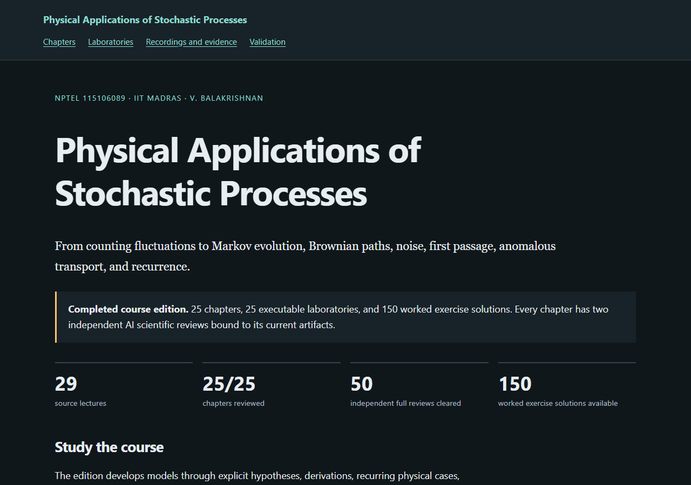

# Physical Applications of Stochastic Processes

**[Read the complete lecture notes](https://az9713.github.io/nptel-stochastic-processes-notes/)** ·
[Download the 233-page PDF](https://az9713.github.io/nptel-stochastic-processes-notes/course-notes.pdf)

[](https://az9713.github.io/nptel-stochastic-processes-notes/)

Independent graduate study notes following **Prof. V. Balakrishnan, IIT Madras**,
[NPTEL 115106089](https://archive.nptel.ac.in/courses/115/106/115106089/).
The [supplied playlist](https://www.youtube.com/playlist?list=PLbMVogVj5nJQo8D9D-D6lMqh4FJbPeE_f)
contains 29 lectures, totaling 28 h 19 min 38 s. This independently authored
study edition adds derivations, examples and computation; it is not an official
NPTEL or IIT Madras publication.

## What is included

- **25 chapters covering all 29 lectures**, with assumptions, derivations,
  physical interpretations, limiting cases and timestamp navigation.
- **150 exercises with complete solutions**, **25 runnable Python labs** and
  **25 original reproducible figures**.
- A **233-page PDF** containing every solution and 25 chapter bookmarks.
- An offline reader with bundled MathJax, dark/light themes, text sizing, search,
  expandable solutions, code copying, full-size figures and print/PDF output.
- **Two independent full AI scientific reviews per chapter**, bound to final
  files with required repair clearances. These are not human expert certification.

[Laboratories](https://az9713.github.io/nptel-stochastic-processes-notes/laboratories.html) ·
[Recording map](https://az9713.github.io/nptel-stochastic-processes-notes/source-map.html) ·
[Notation](plan/notation.md) · [Architecture](plan/architecture.md) ·
[Evidence and limits](VALIDATION.md)

The course builds from counting fluctuations to Markov generators and diffusion,
then develops Wiener paths, spectra and response, first passage, anomalous clocks
and deterministic recurrence. Repeated models expose different questions: the
same equilibrium law can hide different relaxation rates, and the same mean
current can hide different counting statistics.

## Read the chapters online

| Chapter | Topic |
| --- | --- |
| 1 | [Counting fluctuations: discrete distributions and cumulants](https://az9713.github.io/nptel-stochastic-processes-notes/chapter-01-discrete-distributions.html) |
| 2 | [Densities, transformations, and characteristic functions](https://az9713.github.io/nptel-stochastic-processes-notes/chapter-02-continuous-random-variables.html) |
| 3 | [The central limit theorem and the diffusion scale](https://az9713.github.io/nptel-stochastic-processes-notes/chapter-03-central-limit-and-diffusion.html) |
| 4 | [Stable laws, heavy tails, and infinite divisibility](https://az9713.github.io/nptel-stochastic-processes-notes/chapter-04-stable-and-divisible-laws.html) |
| 5 | [From random variables to Markov state descriptions](https://az9713.github.io/nptel-stochastic-processes-notes/chapter-05-processes-and-markov-state.html) |
| 6 | [Generators, detailed balance, and exactly soluble jump processes](https://az9713.github.io/nptel-stochastic-processes-notes/chapter-06-generators-counting-and-telegraph.html) |
| 7 | [Lattice transport and state-dependent birth and death](https://az9713.github.io/nptel-stochastic-processes-notes/chapter-07-lattice-transport-birth-death.html) |
| 8 | [Stationary populations, fluctuations, and physical balance](https://az9713.github.io/nptel-stochastic-processes-notes/chapter-08-stationary-populations.html) |
| 9 | [From jump generators to diffusion equations](https://az9713.github.io/nptel-stochastic-processes-notes/chapter-09-master-to-fokker-planck.html) |
| 10 | [Velocity relaxation and the emergence of spatial diffusion](https://az9713.github.io/nptel-stochastic-processes-notes/chapter-10-ornstein-uhlenbeck-brownian.html) |
| 11 | [Confinement, phase space, and the overdamped limit](https://az9713.github.io/nptel-stochastic-processes-notes/chapter-11-harmonic-and-kramers.html) |
| 12 | [Wiener paths, roughness, and exceptional time statistics](https://az9713.github.io/nptel-stochastic-processes-notes/chapter-12-wiener-paths.html) |
| 13 | [Itô transformations, radial diffusion, and multiplicative noise](https://az9713.github.io/nptel-stochastic-processes-notes/chapter-13-ito-and-radial-diffusion.html) |
| 14 | [Threshold crossings and extremes of smooth random signals](https://az9713.github.io/nptel-stochastic-processes-notes/chapter-14-level-crossing.html) |
| 15 | [Charged Brownian motion and anisotropic diffusion](https://az9713.github.io/nptel-stochastic-processes-notes/chapter-15-magnetic-diffusion.html) |
| 16 | [Noise spectra, filters, and thermal fluctuations](https://az9713.github.io/nptel-stochastic-processes-notes/chapter-16-noise-spectra.html) |
| 17 | [Causality, susceptibility, and fluctuation-dissipation](https://az9713.github.io/nptel-stochastic-processes-notes/chapter-17-linear-response.html) |
| 18 | [Random pulses, counting cumulants, and shot noise](https://az9713.github.io/nptel-stochastic-processes-notes/chapter-18-shot-noise.html) |
| 19 | [Persistent walks and finite-speed diffusion](https://az9713.github.io/nptel-stochastic-processes-notes/chapter-19-telegraph-diffusion.html) |
| 20 | [First passage, absorbing boundaries, and renewal](https://az9713.github.io/nptel-stochastic-processes-notes/chapter-20-first-passage.html) |
| 21 | [Return laws, recurrence, and fractal transport](https://az9713.github.io/nptel-stochastic-processes-notes/chapter-21-returns-and-fractal-walks.html) |
| 22 | [Recurrence by dimension and random walk clocks](https://az9713.github.io/nptel-stochastic-processes-notes/chapter-22-recurrence-dimension-and-clocks.html) |
| 23 | [Renewal memory and anomalous diffusion](https://az9713.github.io/nptel-stochastic-processes-notes/chapter-23-nonmarkovian-anomalous-transport.html) |
| 24 | [Deterministic maps, invariant measures, and coarse observations](https://az9713.github.io/nptel-stochastic-processes-notes/chapter-24-deterministic-probability.html) |
| 25 | [Sojourn, escape, and recurrence in deterministic dynamics](https://az9713.github.io/nptel-stochastic-processes-notes/chapter-25-sojourn-and-dynamical-recurrence.html) |

## Read and run locally

Clone the repository or use **Code → Download ZIP**, extract it, and open
`index.html`. Reading assets work offline; external recordings and papers require
internet access. The retained runtime is Python 3.13.5, with actual library
versions in [runtime-versions.json](runtime-versions.json).

```sh
python -m pip install -r requirements-numerical-lock.txt
python code/ch01_counting.py
python figures/ch01_equal_mean.py
```

Each chapter gives its lab command. Programs use NumPy, SciPy and Matplotlib and
retain actual JSON/text outputs and figure generators. Following the prior NPTEL
and Stanford editions, prose is authored directly in chapter HTML; builders
assemble navigation and manifests rather than scientific exposition.

Rebuild and validate the public snapshot without private source files:

```sh
python -m pip install -r requirements-validation.txt
python -X utf8 tools/check_course.py --release --exported-evidence
python -X utf8 tools/build_course.py --exported-evidence
python -X utf8 tools/reproduce_course.py
python -X utf8 tools/check_reader.py
```

Browser checks use installed Microsoft Edge through Playwright. Public mode
preserves original acceptance records and verifies their scientific hashes; it
does not reopen private reviews. Producer acceptance, finalization and PDF
packaging require retained private evidence/proofs.

## Review, verification and source limits

All 25 chapters have two accepted independent full AI scientific/editorial
reviews (50 total), with final-file hashes and required repair verification.
All 25 labs and figure generators reproduce JSON, text and SVG byte-for-byte in
a source-free copy. Actual offline Edge checks pass at 1440px and 390px widths,
with 4,547 rendered mathematical expressions and no math or JavaScript errors.
Print proofs include all 150 worked solutions.

- [Completion inventory](completion.json), [release gate](validation/release-checks.json)
  and [chapter attestations](validation/chapters/).
- [Structure and links](validation/structure-checks.json),
  [reader checks](validation/reader-checks.json) and
  [source-free reproduction](validation/reproduction-checks.json).
- [Evidence semantics](validation/README.md), [validation limits](VALIDATION.md),
  [production workflow](WORKFLOW.md) and [outline](plan/outline.md).
- [Publication verification](validation/publication-checks.json): 256 served
  files match the content commit, with eight live desktop/phone browser checks.

All 29 acquired caption tracks were read sequentially. Visual checks use sampled
stills with lecture-specific limits; lecture 24 has no visual review. This is
not continuous audiovisual transcription. The [official instructor notes](https://archive.nptel.ac.in/content/storage2/courses/115106089/STOCHASTIC_PROCESSES_NPTEL.pdf)
contain main exposition through lectures 1–11; later chapters use separate
primary/authoritative sources. Derivations, finite computations and AI editorial
review have different scopes.

Raw captions, videos/slides, downloaded papers, private reviews, browser proofs,
credentials, private network configuration and personal absolute paths are
excluded. Third-party materials retain their rights and notices; see
[source and asset attribution](ATTRIBUTION.md).
