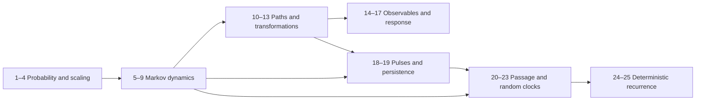

# Architecture — approved

Theory with a parallel computational track. The lecture order is retained.
Each chapter introduces a new modelling capability; every chapter has a distinct
running case, three central result groups, an executable lab, explicit limits,
six worked exercises, and a source note. The three result groups are expanded
into as many exposition sections as their proofs need; they are not three short
summaries. Chapter prose and figures are authored only after plan approval.

| Part | Chapters | New capability |
|---|---|---|
| Probability laws and scaling | 1–4 | infer fluctuations and the correct scaling limit |
| State and probability evolution | 5–9 | construct Markov models and pass from jumps to diffusion |
| Paths, transformations, and observables | 10–17 | derive inertial motion, path properties, crossings, spectra, response |
| Discrete events and random clocks | 18–23 | handle pulses, persistent motion, stopping events, recurrence, memory |
| Probability in deterministic dynamics | 24–25 | transport measures and separate ergodicity from recurrence |

The exact dependency edges are `prerequisites` in `course-plan.json`.

The diagram is a part-level reading guide. The validator checks the finer
chapter and result graph rather than treating every chapter within a part as a
prerequisite for every later part.

## Necessity and overlap decisions

- Chapters 3 and 4 remain separate: finite-variance Gaussian attraction and
  stable heavy tails require different assumptions and different diagnostics.
- Chapters 5–8 introduce state sufficiency, rate evolution, state-dependent
  generators, and stationary/moment solutions in that order. Reusing counting
  laws is deliberate: chapter 1 treats a law; chapters 6–8 treat time evolution.
- Chapters 9–11 revisit diffusion at increasing state resolution: one-coordinate
  density, velocity relaxation, then confined phase space and model reduction.
- Chapters 10 and 19 share ballistic-to-diffusive variance but derive it from
  different mechanisms (Gaussian velocity versus finite-speed switching).
- Chapters 14 and 16 both use covariance; one needs path differentiability and
  the other spectral integrability. Spectra cannot repair undefined crossings.
- Chapters 20–22 separate stopping laws, renewal recurrence, and dimension/clock
  effects. Chapter 23 changes the waiting-time law and therefore memory.
- Chapters 21 and 25 share recurrence language but address different state
  spaces and invariant measures. Their mean-return conclusions are compared
  explicitly, with normalization and conditioning hypotheses beside them.

Budgets: 24 pages for combined-lecture chapters 1, 6, 10, 20; 16 for every other
chapter; total 432. These are typeset-equivalent estimates. No reference appendix
is inserted solely to repeat prerequisites that can be refreshed locally.
